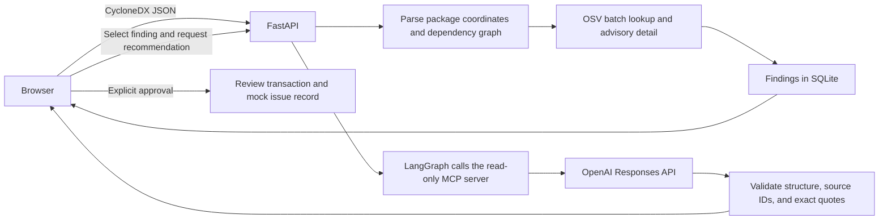

# AgentSec Workbench

AgentSec Workbench is a local application security triage prototype. The Workbench takes a CycloneDX JSON inventory, looks up exact package versions in [OSV](https://google.github.io/osv.dev/post-v1-querybatch/), and drafts a recommendation for a selected finding using [OpenAI Structured Outputs](https://developers.openai.com/api/docs/guides/structured-outputs). The browser shows each citation and lets reviewers inspect its source excerpt.

## Run locally

Use Python 3.12 or later with network access to install dependencies and query OSV. Recommendation generation also requires an OpenAI API key with access to the configured model.

```sh
python3.12 -m venv .venv
source .venv/bin/activate
python -m pip install -r requirements.txt
uvicorn agentsec.main:app --host 127.0.0.1 --port 8000
```

Open [the local workbench](http://127.0.0.1:8000) and click **Run sample scan**, or upload [the synthetic SBOM](samples/workbench-demo.cdx.json). Select the Log4Shell finding (`GHSA-jfh8-c2jp-5v3q`) to see its package, advisory, and fixed range endpoints.

To enable **Generate recommendation**, copy `.env.example` to `.env`, set `OPENAI_API_KEY` in that file, and restart Uvicorn from a shell that exports its values. `OPENAI_MODEL` defaults to [`gpt-6-luna`](https://developers.openai.com/api/docs/models/gpt-6-luna). An override must support Structured Outputs through the Responses API.

```sh
set -a
. ./.env
set +a
uvicorn agentsec.main:app --host 127.0.0.1 --port 8000
```

Review **Risk assessment**, **Recommended steps**, and **What to verify**, then open **Inspect source excerpts**. An upload or a sample scan makes zero OpenAI calls. A click generates a single bounded model request, and subsequent requests for the same finding reuse the result while the scan is available. Upstream OpenAI billing depends on the account, model, and usage.

## Structure

```text
agentsec/
  main.py                    FastAPI routes
  workflow.py                LangGraph scan, triage, and review flows
  mcp_server.py              Read-only MCP server using stdio
  mcp_client.py              Allowlisted tool calls and response verification
  storage.py                 SQLite scans, recommendations, reviews, and audit records
  sbom.py                    CycloneDX parsing and dependency classification
  osv.py                     Batched OSV lookups and advisory normalization
  recommend.py               Retrieval, structured generation, citation validation
  retrieval.py               Local TF-IDF vectors and cosine similarity
  telemetry.py               Token counts and dated cost estimates
  guidance/                  Bundled remediation passages with stable source IDs
  static/                    Browser UI served by FastAPI
samples/                     Synthetic CycloneDX sample
tests/                       Unit, integration, browser, and opt-in live tests
```



## Design decisions and limits

- **Matching** uses versioned Package URLs and OSV's ecosystem-aware matching. The ingestion subset is CycloneDX 1.4–1.7 JSON component inventories, up to 2 MiB and 250 components. It checks Cargo, Composer, RubyGems, Go, Maven, npm, NuGet, and PyPI identifiers. It reports components with missing, conflicting, or unsupported coordinates as skipped. Dependency depth is inferred from the declared path from the metadata component, with unknown depth reported explicitly. The parser validates fields it uses.
- **Enrichment** deduplicates versioned package coordinates, batches up to 50 queries, follows per-query pagination, and fetches each matched advisory once per scan. A lookup failure returns an error. Fixed range endpoints come from exact package coordinates in the advisory when available. The endpoints may span release branches and require verification before an upgrade.
- **Retrieval** indexes version-controlled guidance passages as sparse TF-IDF vectors. Cosine similarity ranks up to two passages, and baseline verification guidance is always included. The index runs locally without embedding API calls. TF-IDF relies on vocabulary overlap. The selected advisory and retrieved excerpts are passed as evidence.
- **Evidence checks** enforce a structured response and verify every cited quote against its named source. An exact quote establishes provenance. A reviewer still needs to judge whether it supports the generated claim and whether the vulnerability is reachable in their runtime.
- **Trust and data flow** use fixed OSV endpoints and send only package coordinates for matching. PURL qualifiers and subpaths are omitted from upstream requests for the supported ecosystems. The model receives the selected package coordinate, advisory excerpts, dependency relationship labels, and bundled guidance. The API supplies no model tools and keeps the key server-side. External evidence is treated as untrusted text and rendered as text in the UI. The model request uses `store=False`. The service is intended for loopback use with synthetic or public SBOMs.
- **MCP** runs the official Python SDK server in a local stdio subprocess. The backend calls three allowlisted read-only tools for advisory, dependency, and guidance data. It verifies advisory and dependency data against the saved finding and guidance against the bundled catalog before using the results. The model receives evidence fields and has no tool or write access.
- **Review** lets the operator draft an issue after a validated recommendation exists. Approval creates one record in the local mock tracker, and rejection closes the review without creating an issue. SQLite commits the decision, mock issue, and audit record together. Repeating the same decision returns the existing result.
- **State** persists in SQLite at `.agentsec/workbench.db` by default. Set `AGENTSEC_DATABASE` to override it. Reloading the page restores a scan from its URL fragment. Run with one Uvicorn worker to deduplicate concurrent model calls. The single-operator loopback app uses unguessable scan and review IDs and has no user accounts.

In an interview, walk through how the same exact package identifier goes from upload to OSV, then show the separate decision to spend a model call on one advisory. The evidence drawer shows what went into that call and what a reviewer needs to verify.

## API

Open [Swagger UI](http://127.0.0.1:8000/docs) or [OpenAPI JSON](http://127.0.0.1:8000/openapi.json).

| Method and path | Behavior |
| --- | --- |
| `GET /health` | Returns process health and whether a key is configured. |
| `GET /sample` | Returns the synthetic CycloneDX JSON file. |
| `POST /api/scans` | Accepts raw CycloneDX JSON with `Content-Type: application/json`. Returns the scan ID, coverage, skipped components, and normalized findings. |
| `GET /api/scans/{scan_id}` | Retrieves a saved scan. |
| `POST /api/scans/{scan_id}/findings/{finding_id}/recommendation` | Returns a structured assessment and its source excerpts. Returns 503 when the key is missing or 502 when the model call or citation validation fails. |

```sh
curl --fail-with-body -H 'Content-Type: application/json' \
  --data-binary @samples/workbench-demo.cdx.json http://127.0.0.1:8000/api/scans
```

## Tests

The default suite uses HTTP transport test doubles for OSV and OpenAI. The integration tests exercise the real FastAPI routes, OSV adapter, and OpenAI SDK request and response handling.

```sh
python -m pip install -r requirements-dev.txt
ruff check .
ruff format --check .
python -m pytest -q
```

Create and review a mock issue from a saved recommendation in the UI or through the issue-review routes in Swagger.

Run the opt-in desktop and mobile browser tests with bundled Chromium. Set `AGENTSEC_CHROMIUM` to the absolute path of an installed Chrome/Chromium executable to use it instead.

```sh
python -m playwright install chromium
AGENTSEC_BROWSER=1 python -m pytest -q -m browser
```

Run the public OSV smoke test or, separately, the one-call OpenAI smoke test. The latter uses the sample's public package data and requires an exported API key.

```sh
AGENTSEC_LIVE_OSV=1 python -m pytest -q tests/test_live.py::test_live_osv
AGENTSEC_LIVE_OPENAI=1 python -m pytest -q tests/test_live.py::test_live_openai
```

## Evaluation and traces

Open **Execution trace** after scanning to see stage and MCP timings, statuses and retries, model token counts, and estimated cost where a dated rate is available. The trace excludes prompts, document text, and API keys. Cost is an estimate using the [published standard GPT‑6 Luna rates](https://developers.openai.com/api/docs/models/gpt-6-luna).

```sh
python scripts/evaluate.py
python scripts/live_smoke.py
```

The first command writes the [fixture evaluation report](evals/results.json). The second uses the configured key for one real OpenAI request and writes the [live smoke report](evals/live-smoke.json). Fixture latency and live latency measure different workloads. Citation results measure quote and source validation and require human judgment for semantic support.

## Project status

See [PROGRESS.md](PROGRESS.md) for completed milestones, test results, blockers, and the next steps.

## Demo and operations

- [Architecture, trust boundaries, and threat model](docs/architecture.md)
- [Docker Compose, hosted demo runbook, and CI](docs/deployment.md)
- [Three-minute technical demo](docs/demo.md)
- [Evaluation summary](docs/evaluation.md)
- [Interview answers and résumé bullets](docs/interview.md)
