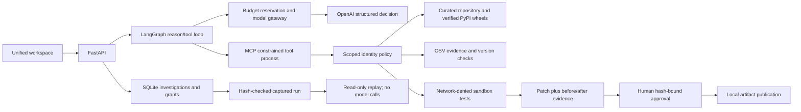

# AgentSec 2.0 architecture and threat model

## Interfaces and decisions

- `investigation/ledger.py`: persisted runs, model call reservations/cache and publication capabilities. Immediate transactions serialize budget checks and grant consumption. Failed/unknown calls retain reservations; actual known usage replaces them. Limits never automatically increase.
- `gateway.py`: typed `Decision`, prompt version, bounded context/output and configurable explicit model prices. Routine parsing, policy, version checks, patch generation and arithmetic use no AI. Unknown pricing fails closed. Usage costs are estimates at the recorded rates, not a billing receipt.
- `engine.py`: bounded conditional LangGraph reasoning/tool loop. Completed tool repetition and insufficient verification terminate safely. Durable checkpoints are application-owned SQLite state snapshots rather than a LangGraph checkpoint plugin; no native LangGraph interrupt API is claimed. Human approval is a separate durable boundary.
- `mcp_server.py` / `tools.py`: typed constrained operations. Identity, workspace and candidate are server-bound, not model arguments. PyPI responses and wheels are verified before extraction. Only known sample paths and commands are supported. No arbitrary repository URL, path, shell argument or code generation is accepted.
- `api.py`: explicit live-run consent, history/resume, read-only replay, policy challenge and grant lifecycle. Publication stores completion and grant consumption atomically. Artifact download validates the approved digest. No external GitHub action occurs in the primary scenario.
- `workspace*.js`: small browser-native component functions for events, evidence, diffs and context panels. DOM text rendering avoids executing untrusted evidence. Replay and live events are never mixed. Presentation navigation advances recorded events without inventing new progress.

## Sandbox trust boundary

The successful live capture used macOS Seatbelt with default denial, network denial, read access to approved runtime libraries and the isolated workspace, and writes limited to that workspace. The interpreter needs a literal root-directory read for startup; this is not recursive root access. A dedicated containment probe confirmed an unrelated temporary file and a network connection remained denied. Process execution is restricted to the Python runtime prefix. Validation has a 20-second timeout and uses only the checked-in fixed harness. The macOS branch does not enforce a separate kernel memory quota; the curated, trusted harness is part of its trust boundary. The Docker branch specifies CPU, memory, process, filesystem and network limits and requires an already-present image.

The Python interpreter, installed runtime libraries, server, SQLite files and curated harness are trusted. The app is not a sandbox for arbitrary untrusted repositories. Filesystem metadata is readable for interpreter startup; user file contents outside the approved paths are not. The live capture made no network requests from inside the validation sandbox.

## Replay provenance and limits

`recordings/hero.json` contains real model decisions, real tool output, tests, timings, cost metadata and the actual diff. Machine-specific workspace prefixes are redacted before capture. The envelope digest detects accidental modification; it is not a digital signature or an independent attestation. Git history supplies versioned provenance. Replay never replays side effects, grants or paid requests. The policy challenge is explicitly deterministic and separate from model behavior.

## Remaining limitations

Single-operator local authentication, model-selected remediation limited to the curated urllib3 example; the separate deterministic repository workflow supports exact Python/npm manifest changes, no generic lockfile solver, no multi-tenant authorization or signed audit trail, no automatic reconciliation of ambiguous external writes, no comprehensive exploitability or human-baseline measurement. Persistent reservations provide conservative accounting under the configured prices; inaccurate operator-supplied prices or provider billing changes require review. Native sandbox capture and real Linux Docker validation of the sample are verified. CI runs the original failing regression and all three passing patched checks. This does not establish arbitrary repository test execution or a separate Docker containment probe. Desktop and mobile layouts were directly reviewed after the temporary browser-review quota cleared; automated browser flows independently test interactions.
