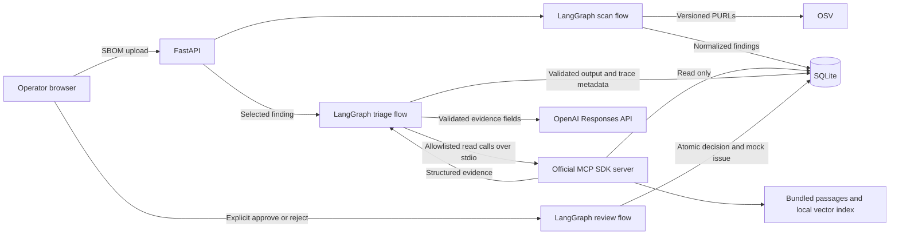

# Architecture and threat model

AgentSec Workbench is a single-operator prototype for reviewing public or synthetic dependency inventories. FastAPI serves the browser interface and the HTTP API. The local demo uses one Uvicorn worker and a persistent SQLite database.

## Workflow and trade-offs

| Stage | What happens and why |
| --- | --- |
| Validate upload | The parser reads the subset of CycloneDX used in the workflow. It canonicalizes versioned package identifiers, computes dependency depth from known edges, and reports skipped components. |
| OSV enrichment | OSV matches versions using ecosystem rules. Batching and advisory deduplication reduce network calls. Retry and pagination limits bound the operation. Advisory fix endpoints may span release branches. |
| Retrieve and invoke tools | LangGraph invokes three read-only MCP tools in a subprocess. The SDK exchanges MCP protocol messages over stdio. Tool names come from a fixed allowlist. Advisory and dependency answers must match the stored finding. Guidance excerpts must match the bundled catalog. |
| Rank context | The corpus consists of curated, labeled passages. TF-IDF embeds the query and passages into the same sparse vector space. Cosine similarity ranks relevant excerpts, with a baseline passage always included. This avoids API calls for embeddings and limits retrieval to vocabulary overlap. |
| Analyze and validate | OpenAI receives the selected finding’s evidence and produces structured text. The backend checks source IDs, quote length, and exact containment. A human reviews semantic support, exposure, and upgrade suitability. |
| Finalize and review | SQLite saves the recommendation before the operator can draft a mock issue. The draft is the durable pause between API requests. A later explicit decision enters the review graph. One transaction stores the decision, the mock issue on approval, and the audit record. Replaying the same decision is idempotent. |

LangGraph manages the ordered stages in each request. SQLite stores completed scans, validated recommendations, traces, and reviews. A process restart preserves those records. A model call interrupted before a validated recommendation is saved may need to be repeated. One worker is used to deduplicate concurrent model calls within a process.

## Threat model

| Threat | Control and verification | Residual risk |
| --- | --- | --- |
| Malformed SBOM or excessive upload | A streamed 2 MiB cap, component cap, supported PURL validation, graph traversal with visited tracking, and provider timeouts. API and parser tests cover invalid documents and conflicts. | A reachable endpoint still consumes resources. Multi-user access needs quotas, authentication, and resource limits. |
| Indirect prompt injection in advisory or guidance | Instructions and evidence use separate fields. The model has no tools or side effects. The browser renders text safely. Eval fixtures inject an issue-creation instruction and verify that no issue is written. | The model can repeat malicious text or cite a genuine quote for a misleading claim. |
| Malformed or malicious MCP response | Fixed local command and tool names, a read-only SQLite connection, typed inputs, bounded calls, and response verification against the saved finding and catalog. The SDK’s default subprocess environment excludes `OPENAI_API_KEY`. Fault tests cover tampering, malformed payloads, and timeout. | The subprocess runs as the app user. Compromise of the app user, the local source tree, or its dependencies can bypass process-level application controls. |
| Unauthorized or repeated issue action | A pending draft and explicit JSON decision scoped to both scan and review identifiers. SQLite prevents duplicate issues and rejects conflicting decisions. REST tests exercise forged IDs, cross-scan decisions, and replays. | This local, single-operator model uses capability-like identifiers. Production would need authenticated reviewers and per-resource authorization. |
| Data disclosure | OSV receives versioned package identifiers with qualifiers and subpaths removed. OpenAI receives only the selected context and uses `store=False`. The trace records timings, outcomes, and model usage without prompts. The repo ignores credentials and the database. | Identifiers and advisories can still reveal information. Use public or synthetic inventories for this prototype. |
| Unsupported recommendation | Strict structured output and exact source and quote validation. Invalid citations block saving a recommendation and drafting an issue. | Exact quotes demonstrate provenance. Runtime reachability and semantic entailment require review. |

## Prototype and production boundaries

The workflow has live OSV and OpenAI integration, persisted review state, and deterministic failure tests. The issue tracker is a local mock. A production rollout would need identity and access controls, model and egress quotas, managed secrets, backups with tested restore, retention controls, and broader grounding and reliability evaluation. Any real issue integration would need a separately scoped credential and idempotency across the network boundary.
